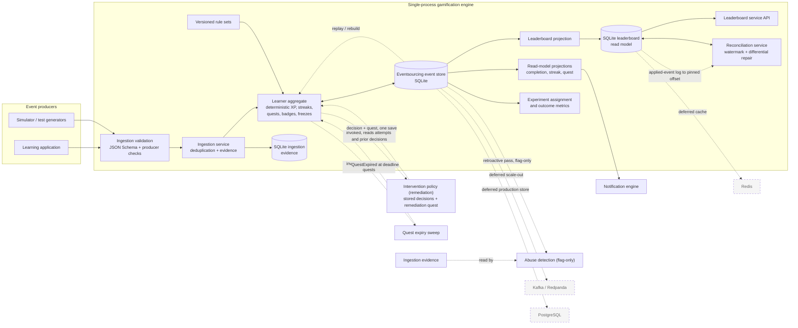

# Gamification, Social Cohort, Notification and Retention Experimentation Engine

An event-sourced gamification engine with deterministic XP, streaks, quests, badges, notifications, and experiments. Rule-based abuse detection (M6) is implemented for synthetic fixtures as a retroactive, flag-only pass, and XP decay exists as an opt-in rule set (`v2`); neither is validated on real data. The current implementation runs as a single process using the `eventsourcing` library with SQLite as its durable event store.

## Architecture



The implemented path runs in one process: producers submit versioned events, ingestion validates and deduplicates them, and the learner aggregate emits durable domain events to the SQLite-backed eventsourcing store. Rebuildable projections provide learner summaries and leaderboard scores; the leaderboard service reads the SQLite leaderboard model and the reconciliation service repairs divergence against the projection's own applied-event log up to a pinned offset (see [ranking-consistency.md](docs/ranking-consistency.md) section 6). Experiment assignment and metrics consume event history. In-app and simulated-push notifications are implemented; a retroactive, flag-only abuse detection pass (`src/abuse`, see [abuse-detection.md](docs/abuse-detection.md)) reads stored facts and ingestion evidence outside ingestion and never changes learner state; Kafka/Redpanda, Redis, and PostgreSQL are deferred extension points rather than active runtime dependencies.

## Documentation

- [Problem Boundaries](docs/problem-boundaries.md)
- [Abuse Detection (M6)](docs/abuse-detection.md)
- [Literature and Landscape Analysis](docs/literature-landscape.md)
- [Metrics Framework](docs/metrics-framework.md)
- [Traceability Matrix and Acceptance Tests](docs/traceability-matrix.md)
- [Event Contracts](docs/event-contracts.md)

The architecture diagram above is the repository's single high-level architecture description. There is no separate architecture document, to avoid duplicate or conflicting descriptions.

## ADRs

- [ADR-0001: Event Pipeline vs. PostgreSQL Outbox](docs/adr/0001-event-sourcing-vs-outbox.md)
- [ADR-0002: Kafka/Redpanda Event Pipeline vs. PostgreSQL](docs/adr/0002-kafka-redpanda-vs-postgres.md)
- [ADR-0003: Rule-Based Abuse Detection](docs/adr/0003-rule-based-abuse-detection.md)
- [ADR-0004: Fixed A/B with Optional Bandit](docs/adr/0004-bandit-vs-fixed-ab.md)
- [ADR-0005: Eventsourcing and SQLite First](docs/adr/0005-eventsourcing-sqlite-first.md)
- [ADR-0006: Decay in the Reward Path, Detection Stays Flag-Only](docs/adr/0006-decay-in-reward-path.md)
- [ADR-0007: Rule-Based Remediation Policy with Stored Decisions](docs/adr/0007-rule-based-remediation-policy.md)

## How to Run Locally

1. Create and activate a Python 3.11+ virtual environment. For the exact pinned versions, use `pip install -r requirements-lock.txt && pip install -e . --no-deps` instead of the steps below.
2. Install the project and its development dependencies defined in `pyproject.toml`:

   ```bash
   python -m pip install -e ".[dev]"
   ```

3. Run the tests:

   ```bash
   python -m pytest
   ```

   `pytest -m integration` runs the packaging test.

Kafka/Redpanda, Redis, and PostgreSQL setup instructions will be added only if measured scale or reliability needs require those components.

## Running the web UI

A learner home page serves seeded demo data (UI layer in `webapp/`, not engine state). By default it is **read-only**: the existing endpoints only serve pre-seeded SQLite snapshots and no events can be submitted through the UI.

```bash
python -m pip install -e ".[web]"
```

```bash
python -m webapp.seed
```

```bash
python -m uvicorn webapp.app:app --port 8000
```

Then open <http://localhost:8000/>.

### DEMO_MODE — writable sandbox

Set `DEMO_MODE=1` together with `DEMO_SANDBOX_PATH` to run a writable sandbox copy of the stores. `DEMO_SANDBOX_PATH` is required when `DEMO_MODE=1`; if its live profile is absent, the server seeds a fresh golden snapshot into `<DEMO_SANDBOX_PATH>/golden`, copies it to `<DEMO_SANDBOX_PATH>/live`, and routes all reads to the live copy. POST endpoints become available to submit events against the live stores.

```bash
DEMO_MODE=1 DEMO_SANDBOX_PATH=/tmp/demo-sandbox \
  python -m uvicorn webapp.app:app --port 8000
```

**Demo clock** — the demo clock is **per-learner**. Set a learner's simulated "now" to any UTC instant and subsequent submissions use that instant as `occurred_at` and `ingested_at`:

```bash
# Read learner clock
curl http://localhost:8000/api/demo/learners/<id>/clock

# Set learner clock
curl -X POST http://localhost:8000/api/demo/learners/<id>/clock \
     -H "Content-Type: application/json" \
     -d '{"now_utc":"2026-10-20T10:00:00Z"}'

# Submit a lesson completion
curl -X POST http://localhost:8000/api/demo/learners/<id>/lesson-complete \
     -H "Content-Type: application/json" \
     -d '{"lesson_id":"lesson_intro_1","completion_kind":"lesson"}'

# Submit a checkpoint attempt
curl -X POST http://localhost:8000/api/demo/learners/<id>/checkpoint \
     -H "Content-Type: application/json" \
     -d '{"assessment_id":"quiz_1","passed":false}'

# Reset sandbox to seeded state
curl -X POST http://localhost:8000/api/demo/reset
```

After every accepted event the leaderboard projection and (for failed checkpoints) the remediation notification hook run synchronously inside the same submit lock. After every lesson submission the demo also runs the flag-only abuse pass for that learner (a stand-in for the tick's abuse step), so abuse flags appear immediately. Seeded learners carry no ingestion evidence; all data is synthetic.

**Where demo notifications go.** In-app messages appear in the learner's inbox on the home page. Push has no real provider (that would need Firebase/APNs and a device token): delivered pushes are shown as phone notifications under *Delivered to phone and email* in the admin Notifications tab. Email is sent over real SMTP when an account is configured, otherwise it is recorded in that local outbox only. The admin button **Create a free Ethereal fake inbox** creates a throwaway [Ethereal](https://ethereal.email) account (needs internet on the machine running the demo); Ethereal accepts mail and shows it in its web inbox but never delivers it. The account is saved as `<DEMO_SANDBOX_PATH>/email_account.json`, so Reset demo keeps it. **Recommended: a local Mailpit inbox** (no account, no internet). Start it, then click **Use local Mailpit inbox** in the admin Notifications tab; every email the demo sends, to any learner address, appears at <http://localhost:8025>:

```bash
docker run -d --name mailpit -p 8025:8025 -p 1025:1025 axllent/mailpit
# or without Docker: download the binary from https://github.com/axllent/mailpit/releases and run ./mailpit
```

Delivered pushes also pop up as browser notifications in the Demo split view (click **Show pushes as browser notifications** once), and the split view's **Push provider: up/down** button simulates a provider outage from the learner side: pushes go to the dead-letter queue, and when the provider is back the recovery worker re-sends them automatically. Any other SMTP test inbox can be used through the form in the same card or with `DEMO_SMTP_HOST`, `DEMO_SMTP_PORT`, `DEMO_SMTP_USER`, `DEMO_SMTP_PASS` (optional `DEMO_SMTP_FROM`, `DEMO_SMTP_SECURE=1`, `DEMO_SMTP_WEB`).

## Running the engine on a schedule

`scripts/run_engine_tick.py` runs ONE tick of the engine's caller-run jobs and exits: the weekly cohort cycle, the exp_007 assignment of learners not yet assigned (`assigned_at` = `--now`, with an eligibility row each; already-assigned learners are left as they are), the leaderboard poll, quest expiry, remediation decisions and notices, the streak-risk sweep, the abuse (flag-only) pass, and a reconciliation of the epoch's global and cohort leaderboard scopes. It is a one-shot command run by cron (or any scheduler you choose); **the engine has no built-in scheduler**. Every instant comes from `--now` (timezone-aware ISO 8601). Each step is isolated: one that fails is reported under its name with an `error` and the others still run. The summary is printed as sorted-key JSON (and written to `--out` if given); the exit code is 1 if any step reported an error, 2 for bad arguments, else 0.

```bash
python scripts/run_engine_tick.py --db engine.db --leaderboard-db leaderboard.db \
    --prefs prefs.json --now "$(date -u +%Y-%m-%dT%H:%M:%S+00:00)" --out tick.json
```

Example crontab lines (a tick is safe to repeat; running it twice for the same instant does no new work):

```cron
# weekly, Monday 00:10 UTC
10 0 * * 1 cd /path/to/gamification-engine && python scripts/run_engine_tick.py --db engine.db --leaderboard-db leaderboard.db --prefs prefs.json --now "$(date -u +\%Y-\%m-\%dT\%H:\%M:\%S+00:00)" --out tick.json
# hourly
0 * * * * cd /path/to/gamification-engine && python scripts/run_engine_tick.py --db engine.db --leaderboard-db leaderboard.db --prefs prefs.json --now "$(date -u +\%Y-\%m-\%dT\%H:\%M:\%S+00:00)" --out tick.json
```

(In a crontab `%` must be escaped as `\%`, as above.) The tick's own assign step runs before the streak-risk sweep, so new learners are assigned to exp_007 in the same tick (`scripts/run_experiment.py assign` does the same on demand).

## Reproducing the evidence

- `requirements-lock.txt` pins the exact dependency versions used for the recorded test runs.
- `scripts/capture_evidence.sh` writes the commit, environment and full pytest output to `docs/evidence/<short-sha>/`; run it only on a clean, committed tree.
- `.github/workflows/ci.yml` runs the same install and test steps on GitHub Actions.

## Milestone Status

| Milestone | Description | Status |
|-----------|-------------|--------|
| M1 | Canonical engagement events | ☑ (lesson_completed and checkpoint_attempted ingested; ID binding, late window, rule selection tested; engine-produced events and notifications carry correlation and causation ids and trace_delivery follows them) |
| M2 | Deterministic gamification | ☑ (slice done: XP, streak/freezes, one quest, one badge, replay) |
| M3 | Cohorts and leaderboards | ☑ (leaderboard duplicate, restart, offset and time handling tested; weekly cohort builder implemented (prior-week lesson tier, lesson-id module prefix, 30-day inactivity filter, split, merge into the nearest cohort, late arrivals counted toward sizes, bucket counts chosen from group size); leaderboard poller and weekly cycle available (invoked by the synthetic harness and demo seed); the builder, poller, weekly cycle and reconciliation are run by scripts/run_engine_tick.py and scheduled by the caller (cron); known gaps: sealing is caller-invoked, and member count covers learners assigned for the current weekly epoch; notification-log polling is the tick's poll step, scheduled by the caller (cron), not by the engine; reconciliation rebuilds from the projection's applied-event log) |
| M4 | Intervention/quest policy | ☑ (implemented for synthetic fixtures: checkpoint_attempted ingestion, rule-based remediation policy with stored decisions, remediation_v1 quest (remediation completions only), deadline expiry sweep; policy and sweep run by scripts/run_engine_tick.py and scheduled by the caller (cron); an opt-in notification wrapper (`src/interventions/notification_hook.py`) sends one remediation notice per assign decision (push by default, deduped by proposal id), likewise run by scripts/run_engine_tick.py and scheduled by the caller (cron)) |
| M5 | Multi-channel notifications | ☑ (in-app, simulated-push and simulated-email slice implemented; email shares the push guardrails: the daily cap of 5 messages per learner per channel (in-app, push and email each have their own 5, reset at the learner's local midnight); each scheduled exp_007 streak-risk reminder is sent on in-app, push and email at the same time (email when the learner's preferences have an address) and quiet hours 22:00–08:00; the exp_007 streak-risk reminder generator (`src/notifications/streak_risk.py`) and the experiment variant flag on notification proposals exist, and cap breaches of experiment proposals are recorded as guardrail violations; the generator skips learners whose streak can no longer be extended (same continuation rule as `calculate_streak`, a freeze can bridge one missed day) and applies the exp_007 exclusions (platform tenure under 3 days from the learner's Created event, opt-out of push or of streak_risk); the reminder sweep is run by scripts/run_engine_tick.py, scheduled by the caller (cron) (it can record one decision row per learner outcome in the experiment store), and the recorded violations are read by the M7 runner (`run_experiment` counts rows with reason `daily_cap_exceeded` per learner per UTC day; a treatment-arm breach invalidates the run)) |
| M6 | Abuse detection | ☑ (implemented for synthetic fixtures; flag-only; the abuse pass is run by scripts/run_engine_tick.py (flag-only), scheduled by the caller (cron); thresholds unvalidated on real data; XP decay is opt-in ruleset `v2`) |
| M7 | Experimentation and metrics | ☑ (experiment assignment recorded as `ExperimentAssigned` and treatment-surface exposure as `ExperimentExposed` (AT-12 and AT-13 passing; synthetic fixtures; control learners never produce exposure events); the experiment runner `run_experiment`, the eligibility and decision stores, the manual entry point `scripts/run_experiment.py` (`assign`, `sweep`, `report`; assign and the streak-risk sweep are run by scripts/run_engine_tick.py, scheduled by the caller (cron), and `report` is run by scripts/run_experiment.py; notification preferences come from a JSON file, not the event log) and the real-log reproduction check exist and are tested; it reports per-arm mastery (completions derived from the stored attempts), exposure, fatigue (messages per learner per day over each learner's observed window of at most 14 days, delivered-over-cap and opt-out counts), a treatment-minus-control contrast and a sample-ratio check, and marks the run invalid with `invalid_reasons` (treatment cap breach, treatment delivered-over-cap, gaming share, sample ratio, missing eligibility records, no eligible learners, mixed assessment versions) while still reporting every number; acting on that verdict is the caller's job and is not automated; exposure is not consumed by the metric (a per-arm diagnostic, control None); simulator implemented for synthetic data (pilot v1 and the generator functions, see `simulator/SPEC.md`); AT-18 passing, simulator-backed synthetic) |
| M8 | Scale and recovery | ☑ (pinned synthetic workload, multi-learner full-state rebuild AT-15 (the wipe destroys all derived state, i.e. the leaderboard and projections, and rebuilds from the retained event log with a fresh application instance; the event log itself is not wiped; synthetic population is small: 15 learners, 843 replayed entries), leaderboard p50/p95/p99 latency bounds, DLQ outage recovery drain, raw-log experiment reproduction). A separate benchmark (scripts/run_scale_benchmark.py, xlarge profile; results in report.json) runs 1000 learners and 114974 events, with bit-identical rebuild, leaderboard latency bounds, DLQ outage recovery and engine and experiment reproduction. |

M1 means events from the learning app are validated against versioned schemas before acceptance (currently `lesson_completed` and `checkpoint_attempted` are ingested), while M2 means XP, streaks, freezes, one quest, and one badge are computed deterministically and can be rebuilt exactly from the event history. M3 means synthetic learners are deterministically grouped into bounded cohorts (500–5,000 members; the 30-day inactivity filter and nearest-cohort merging run inside the weekly cohort builder; the builder, a leaderboard poller and a weekly cycle are run by scripts/run_engine_tick.py and scheduled by the caller (cron), not by the engine itself) and ranked at cohort and global levels via SQLite projections with exact tie-breaking, measurable latency, and differential reconciliation (AT-7).

## Planned Placeholder Tests

| Test | Milestone | Status |
|------|-----------|--------|
| `test_point_farming` | M6 | passing (AT-6; synthetic fixtures, flag-only) |
| `test_learning_remediation` | M4 | passing (AT-17; synthetic fixtures; the remediation policy and expiry sweep are run by scripts/run_engine_tick.py, scheduled by the caller (cron)) |
| `test_notification_fatigue` | M5 | passing (AT-14; synthetic fixtures) |
| `test_opt_out_enforcement` | M5 | passing (AT-11; synthetic fixtures) |
| `test_quiet_hour_delay` | M5 | passing (AT-8; synthetic fixtures) |
| `test_retry_dlq` | M5 | passing (AT-10; synthetic fixtures) |
| `test_leaderboard_reconciliation` | M3 | passing (AT-7) |
| `test_full_state_rebuild` | M2, M7, M8 | passing (AT-15; multi-learner full-state disaster recovery) |
| `test_assignment_vs_exposure` | M7 | passing (AT-13; synthetic fixtures) |
| `test_exposure_is_logged_only_after_treatment_surface_view` | M7 | passing (AT-13; synthetic fixtures) |
| `test_policy_comparison` | M7 | passing (AT-18; simulator-backed synthetic) |
