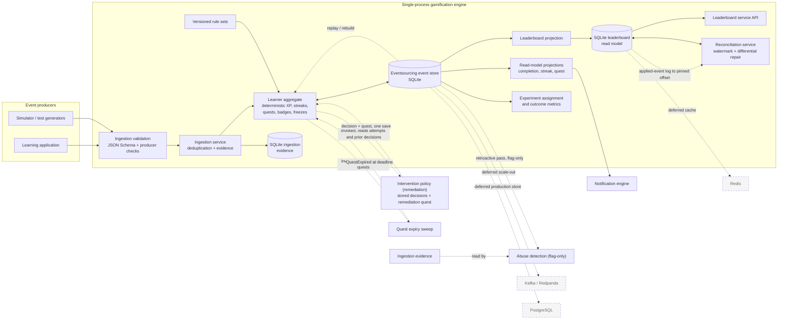

# Gamification, Social Cohort, Notification and Retention Experimentation Engine

> **Changelog (2026-11-09):** Demo backend (`webapp/demo_backend.py`): `create_sandbox` seeds fresh SQLite stores and `Sandbox` exposes `submit_lesson_completed`, `submit_checkpoint`, `set_clock`/`get_clock`, and `reset`; the demo clock is per-learner. After every accepted event the leaderboard projection and the remediation notification hook run synchronously inside the same lock. Seeded learners carry no ingestion evidence; all data is synthetic. The web UI can now be run in a writable DEMO_MODE (see "Running the web UI" below).

> **Changelog (2026-11-07):** M3 wording: cohort admission is now atomic (member count, capacity check and write share one write-locked SQLite transaction); the "capacity check not transactional" known gap was removed.

> **Changelog (2026-11-07):** M7 wording: AT-18 (policy comparison) now passes on the synthetic simulator (`tests/simulator/test_policy_comparison.py`); eligibility, decision and delivery are simulator stand-ins, and exposure is still not consumed by the metric.

> **Changelog (2026-11-06):** M7 wording: experiment assignment is recorded as `ExperimentAssigned` and treatment-surface exposure as `ExperimentExposed` (AT-12 and AT-13 passing on synthetic fixtures); the two M7 placeholder tests now pass; exposure is not yet consumed by the metric.

> **Changelog (2026-11-02):** M8 wording: the AT-15 wipe destroys all derived state and rebuilds from the retained event log with a fresh application instance; the synthetic population is small (15 learners).

> **Changelog (2026-11-02):** Added ADR-0007 (rule-based remediation policy) to the ADR list; the M1 description now names both ingested event types.

> **Changelog (2026-10-12):** Documented the current single-process eventsourcing and SQLite architecture; marked Kafka/Redpanda, Redis, and PostgreSQL as deferred options.

An event-sourced gamification engine with deterministic XP, streaks, quests, badges, notifications, and experiments. Rule-based abuse detection (M6) is implemented for synthetic fixtures as a retroactive, flag-only pass, and XP decay exists as an opt-in rule set (`v2`); neither is validated on real data. The current implementation runs as a single process using the `eventsourcing` library with SQLite as its durable event store.

## Architecture



The implemented path runs in one process: producers submit versioned events, ingestion validates and deduplicates them, and the learner aggregate emits durable domain events to the SQLite-backed eventsourcing store. Rebuildable projections provide learner summaries and leaderboard scores; the leaderboard service reads the SQLite leaderboard model and the reconciliation service repairs divergence against the projection's own applied-event log up to a pinned offset (see [ranking-consistency.md](docs/ranking-consistency.md) section 6). Experiment assignment and metrics consume event history. In-app and simulated-push notifications are implemented; a retroactive, flag-only abuse detection pass (`src/abuse`, see [abuse-detection.md](docs/abuse-detection.md)) reads stored facts and ingestion evidence outside ingestion and never changes learner state; Kafka/Redpanda, Redis, and PostgreSQL are deferred extension points rather than active runtime dependencies.

## Documentation

- [Problem Boundaries](docs/problem-boundaries.md)
- [Abuse Detection (M6)](docs/abuse-detection.md)
- [Literature and Landscape Analysis](docs/literature-landscape.md)
- [Metrics Framework](docs/metrics-framework.md)
- [Traceability Matrix and Acceptance Tests](docs/traceability-matrix.md)
- [Event Contracts](docs/event-contracts.md)

The architecture diagram above is the repository's single high-level architecture description. There is no separate architecture document, to avoid duplicate or conflicting descriptions.

## ADRs

- [ADR-0001: Event Pipeline vs. PostgreSQL Outbox](docs/adr/0001-event-sourcing-vs-outbox.md)
- [ADR-0002: Kafka/Redpanda Event Pipeline vs. PostgreSQL](docs/adr/0002-kafka-redpanda-vs-postgres.md)
- [ADR-0003: Rule-Based Abuse Detection](docs/adr/0003-rule-based-abuse-detection.md)
- [ADR-0004: Fixed A/B with Optional Bandit](docs/adr/0004-bandit-vs-fixed-ab.md)
- [ADR-0005: Eventsourcing and SQLite First](docs/adr/0005-eventsourcing-sqlite-first.md)
- [ADR-0006: Decay in the Reward Path, Detection Stays Flag-Only](docs/adr/0006-decay-in-reward-path.md)
- [ADR-0007: Rule-Based Remediation Policy with Stored Decisions](docs/adr/0007-rule-based-remediation-policy.md)

## How to Run Locally

1. Create and activate a Python 3.11+ virtual environment. For the exact pinned versions, use `pip install -r requirements-lock.txt && pip install -e . --no-deps` instead of the steps below.
2. Install the project and its development dependencies defined in `pyproject.toml`:

   ```bash
   python -m pip install -e ".[dev]"
   ```

3. Run the tests:

   ```bash
   python -m pytest
   ```

   `pytest -m integration` runs the packaging test.

Kafka/Redpanda, Redis, and PostgreSQL setup instructions will be added only if measured scale or reliability needs require those components.

## Running the web UI

A learner home page serves seeded demo data (UI layer in `webapp/`, not engine state). By default it is **read-only**: the existing endpoints only serve pre-seeded SQLite snapshots and no events can be submitted through the UI.

```bash
python -m pip install -e ".[web]"
```

```bash
python -m webapp.seed
```

```bash
python -m uvicorn webapp.app:app --port 8000
```

Then open <http://localhost:8000/>.

### DEMO_MODE — writable sandbox

Set `DEMO_MODE=1` together with `DEMO_SANDBOX_PATH` to run a writable sandbox copy of the stores. `DEMO_SANDBOX_PATH` is required when `DEMO_MODE=1`; if its live profile is absent, the server seeds a fresh golden snapshot into `<DEMO_SANDBOX_PATH>/golden`, copies it to `<DEMO_SANDBOX_PATH>/live`, and routes all reads to the live copy. POST endpoints become available to submit events against the live stores.

```bash
DEMO_MODE=1 DEMO_SANDBOX_PATH=/tmp/demo-sandbox \
  python -m uvicorn webapp.app:app --port 8000
```

**Demo clock** — the demo clock is **per-learner**. Set a learner's simulated "now" to any UTC instant and subsequent submissions use that instant as `occurred_at` and `ingested_at`:

```bash
# Read learner clock
curl http://localhost:8000/api/demo/learners/<id>/clock

# Set learner clock
curl -X POST http://localhost:8000/api/demo/learners/<id>/clock \
     -H "Content-Type: application/json" \
     -d '{"now_utc":"2026-10-20T10:00:00Z"}'

# Submit a lesson completion
curl -X POST http://localhost:8000/api/demo/learners/<id>/lesson-complete \
     -H "Content-Type: application/json" \
     -d '{"lesson_id":"lesson_intro_1","completion_kind":"lesson"}'

# Submit a checkpoint attempt
curl -X POST http://localhost:8000/api/demo/learners/<id>/checkpoint \
     -H "Content-Type: application/json" \
     -d '{"assessment_id":"quiz_1","passed":false}'

# Reset sandbox to seeded state
curl -X POST http://localhost:8000/api/demo/reset
```

After every accepted event the leaderboard projection and (for failed checkpoints) the remediation notification hook run synchronously inside the same submit lock. Seeded learners carry no ingestion evidence; all data is synthetic.

## Reproducing the evidence

- `requirements-lock.txt` pins the exact dependency versions used for the recorded test runs.
- `scripts/capture_evidence.sh` writes the commit, environment and full pytest output to `docs/evidence/<short-sha>/`; run it only on a clean, committed tree.
- `.github/workflows/ci.yml` runs the same install and test steps on GitHub Actions.

## Milestone Status

| Milestone | Description | Status |
|-----------|-------------|--------|
| M1 | Canonical engagement events | ☐ (partial: lesson_completed and checkpoint_attempted ingested; ID binding, late window, rule selection tested) |
| M2 | Deterministic gamification | ☑ (slice done: XP, streak/freezes, one quest, one badge, replay) |
| M3 | Cohorts and leaderboards | ☐ (leaderboard duplicate, restart, offset and time handling tested; known gaps: cohort merge helper not wired in, member count covers learners assigned for the current weekly epoch (30-day inactivity pruning not wired in); no production notification-log poller; reconciliation rebuilds from the projection's applied-event log) |
| M4 | Intervention/quest policy | ☐ (implemented for synthetic fixtures: checkpoint_attempted ingestion, rule-based remediation policy with stored decisions, remediation_v1 quest (remediation completions only), deadline expiry sweep; policy and sweep invoked, not scheduled; an opt-in notification wrapper (`src/interventions/notification_hook.py`) sends one remediation notice per assign decision (push by default, deduped by proposal id), still invoked and not scheduled) |
| M5 | Multi-channel notifications | ☐ (in-app, simulated-push and simulated-email slice implemented; email shares the push guardrails: the 5-per-24h cap and quiet hours 22:00–08:00) |
| M6 | Abuse detection | ☐ (implemented for synthetic fixtures; flag-only; thresholds unvalidated on real data; XP decay is opt-in ruleset `v2`) |
| M7 | Experimentation and metrics | ☐ (experiment assignment recorded as `ExperimentAssigned` and treatment-surface exposure as `ExperimentExposed` (AT-12 and AT-13 passing; synthetic fixtures; control learners never produce exposure events); exposure not yet consumed by the metric; simulator partially implemented (pilot v1); AT-18 passing, simulator-backed synthetic) |
| M8 | Scale and recovery | ☑ (pinned synthetic workload, multi-learner full-state rebuild AT-15 (the wipe destroys all derived state, i.e. the leaderboard and projections, and rebuilds from the retained event log with a fresh application instance; the event log itself is not wiped; synthetic population is small: 15 learners, 612 replayed entries), leaderboard p50/p95/p99 latency bounds, DLQ outage recovery drain, raw-log experiment reproduction) |

M1 means events from the learning app are validated against versioned schemas before acceptance (currently `lesson_completed` and `checkpoint_attempted` are ingested), while M2 means XP, streaks, freezes, one quest, and one badge are computed deterministically and can be rebuilt exactly from the event history. M3 means synthetic learners are deterministically grouped into bounded cohorts (500–5,000 members; 30-day inactivity pruning is specified but not yet scheduled or wired in) and ranked at cohort and global levels via SQLite projections with exact tie-breaking, measurable latency, and differential reconciliation (AT-7).

## Planned Placeholder Tests

| Test | Milestone | Status |
|------|-----------|--------|
| `test_point_farming` | M6 | passing (AT-6; synthetic fixtures, flag-only) |
| `test_learning_remediation` | M4 | passing (AT-17; synthetic fixtures; policy and sweep invoked, not scheduled) |
| `test_notification_fatigue` | M5 | planned placeholder |
| `test_opt_out_enforcement` | M5 | planned placeholder |
| `test_quiet_hour_delay` | M5 | planned placeholder |
| `test_retry_dlq` | M5 | planned placeholder |
| `test_leaderboard_reconciliation` | M3 | passing (AT-7) |
| `test_full_state_rebuild` | M2, M7, M8 | passing (AT-15; multi-learner full-state disaster recovery) |
| `test_assignment_vs_exposure` | M7 | passing (AT-13; synthetic fixtures) |
| `test_exposure_is_logged_only_after_treatment_surface_view` | M7 | passing (AT-13; synthetic fixtures) |
| `test_policy_comparison` | M7 | passing (AT-18; simulator-backed synthetic) |
