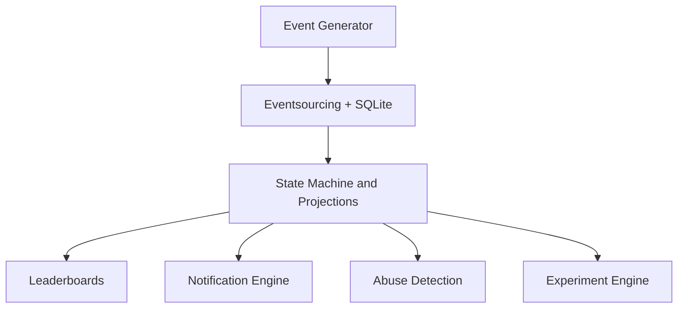

# Gamification, Social Cohort, Notification and Retention Experimentation Engine

> **Changelog (2026-10-12):** Documented the current single-process eventsourcing and SQLite architecture; marked Kafka/Redpanda, Redis, and PostgreSQL as deferred options.

An event-sourced gamification engine with deterministic XP, streaks, quests, badges, notifications, experiments, and rule-based abuse detection. The current implementation runs as a single process using the `eventsourcing` library with SQLite as its durable event store.

## Architecture



All components currently run in one process against the SQLite-backed event store. Kafka/Redpanda, Redis, PostgreSQL, independent consumers, and adaptive policies are deferred until measurements demonstrate that their operational cost is justified.

## Documentation

- [Problem Boundaries](docs/problem-boundaries.md)
- [Literature and Landscape Analysis](docs/literature-landscape.md)
- [Metrics Framework](docs/metrics-framework.md)
- [Traceability Matrix and Acceptance Tests](docs/traceability-matrix.md)
- [Event Contracts](docs/event-contracts.md)

The architecture diagram above is the repository's single high-level architecture description. There is no separate architecture document, to avoid duplicate or conflicting descriptions.

## ADRs

- [ADR-0001: Event Pipeline vs. PostgreSQL Outbox](docs/adr/0001-event-sourcing-vs-outbox.md)
- [ADR-0002: Kafka/Redpanda Event Pipeline vs. PostgreSQL](docs/adr/0002-kafka-redpanda-vs-postgres.md)
- [ADR-0003: Rule-Based Abuse Detection](docs/adr/0003-rule-based-abuse-detection.md)
- [ADR-0004: Fixed A/B with Optional Bandit](docs/adr/0004-bandit-vs-fixed-ab.md)
- [ADR-0005: Eventsourcing and SQLite First](docs/adr/0005-eventsourcing-sqlite-first.md)

## How to Run Locally

1. Create and activate a Python 3.11+ virtual environment.
2. Install the project and its development dependencies defined in `pyproject.toml`:

   ```bash
   python -m pip install -e ".[dev]"
   ```

3. Run the tests:

   ```bash
   python -m pytest
   ```

Kafka/Redpanda, Redis, and PostgreSQL setup instructions will be added only if measured scale or reliability needs require those components.

## Milestone Status

| Milestone | Description | Status |
|-----------|-------------|--------|
| M1 | Canonical engagement events | ☐ (Updated schemas for all the events) |
| M2 | Deterministic gamification | ☑ (slice done: XP, streak/freezes, one quest, one badge, replay) |
| M3 | Cohorts and leaderboards | ☑ (SQLite projections, deterministic ties, differential reconciliation AT-7, latency benchmarks) |
| M4 | Intervention/quest policy | ☐ |
| M5 | Multi-channel notifications | ☐ |
| M6 | Abuse detection | ☐ |
| M7 | Experimentation and metrics | ☐ |
| M8 | Scale and recovery | ☐ |

M1 means events from the learning app are validated against versioned schemas before acceptance (currently only `lesson_completed` is ingested), while M2 means XP, streaks, freezes, one quest, and one badge are computed deterministically and can be rebuilt exactly from the event history. M3 means synthetic learners are deterministically grouped into bounded cohorts (500–5,000 members, 30-day inactivity pruning) and ranked at cohort and global levels via SQLite projections with exact tie-breaking, measurable latency, and differential reconciliation (AT-7).

## Planned Placeholder Tests

| Test | Milestone | Status |
|------|-----------|--------|
| `test_point_farming` | M6 | planned placeholder |
| `test_duplicate_proposals` | M5 | planned placeholder |
| `test_notification_fatigue` | M5 | planned placeholder |
| `test_opt_out_enforcement` | M5 | planned placeholder |
| `test_quiet_hour_delay` | M5 | planned placeholder |
| `test_retry_dlq` | M5 | planned placeholder |
| `test_leaderboard_reconciliation` | M3 | passing (AT-7) |
| `test_full_state_rebuild` | M2, M7, M8 | planned placeholder |
| `test_assignment_vs_exposure` | M7 | planned placeholder |
| `test_exposure_is_logged_only_after_treatment_surface_view` | M7 | planned placeholder |
